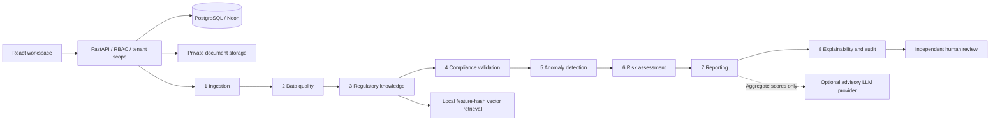

# Architecture and trust boundaries

RegulaTrust uses a React 19 / TypeScript / Vite frontend with Tailwind, a shadcn-style Radix Button primitive, Lucide, and Recharts. FastAPI exposes authenticated REST endpoints. SQLAlchemy persists normalized records in PostgreSQL. Alembic provisions 22 application tables: the 20 requested domain tables plus revocable authentication sessions and one-use password reset tokens.

## Data and execution

The live deployment uses `STORAGE_CONFIGURATION=database`: uploaded originals persist in Neon in an organization-scoped bytea column. Originals are deferred in ORM reads and excluded from API serialization. Local installations can continue using the private filesystem mode described below.

Each document has an organization, uploader, SHA-256 digest, private path, normalized banking records and reporting periods. Agent runs have unique IDs. All eight execution records are committed before processing. Each stage is visible while running and stores JSON output, software version, attempts, duration, progress and record counts. Pure agents are retried twice without duplicating persisted findings. Result entities and the immutable report snapshot are committed together after all agents succeed. A failure preserves execution history and marks the document failed. Processing uses synchronous HTTP execution; this implementation does not include a distributed task queue or crash recovery for a terminated worker. A worker terminated mid-run can leave `Running` status requiring operator investigation.

Live dashboards select the latest completed run for each document. Historical reports retain their original outcomes and evidence. Report generation creates a new snapshot record linked to its source run; approvals cannot mutate its evidence. PostgreSQL row locking prevents simultaneous reviewer decisions on the same report.

## Regulatory authority

No RBI, Basel III, IFRS 9 or AML requirement is represented as verified out of the box. Administrators explicitly configure institution/jurisdiction applicability, source text, HTTPS citation, source version, exact clause and deterministic comparison. Administrator verification is an attestation, not an automated legal authority check. Source authenticity and legal applicability must be assessed by qualified institution staff. Only enabled frameworks participate. The newest configured rule version per framework/code supersedes earlier versions for new runs; historic reports retain older versions.

The synthetic demo framework is excluded from non-demo documents. A demo check can pass or fail, but the validation status remains `Needs Review` because its source is illustrative. Compliance score is `null` without verified checks. Missing values and unavailable sources cannot produce a compliant result. Empty control sets cannot be approved.

Rule operators are an allowlist: `gte`, `lte`, `eq`, `required`. Rules are never executed as code. Capital adequacy divides non-negative capital by positive risk-weighted assets. Non-finite values and invalid denominators require review. The source, clause, versions, observed/expected values, row, and document digest accompany each result.

Knowledge retrieval uses a deterministic, normalized 256-dimensional SHA-256 feature-hash text embedding and cosine similarity. It is a lightweight local lexical vector baseline, not a semantic transformer embedding. Retrieval does not assert authority or change the configured applicable rule set. Optional OpenAI-compatible LLM narratives receive aggregate risk scores and curated corrective actions only. They are labeled non-authoritative and logged with the model version; they never decide compliance.

## Quality, anomalies and risk

Required fields, numeric types, non-negative amounts, positive risk-weighted assets, ISO reporting dates and duplicate account/date keys determine quality. The quality score counts unique defective cells against seven expected fields per row. Reporting dates are enumerated; the system does not infer an institution's filing schedule.

Modified z-score detection uses the median and median absolute deviation (MAD), with threshold 3.5. If MAD is zero it uses distance relative to the median, with a minimum scale of 1. Fewer than five numeric observations skip cross-sectional detection. Historical comparison flags absolute exposure changes above 100% against the most recent earlier date for the same account in this organization. These transparent heuristics are review signals, not calibrated fraud probabilities. No Isolation Forest is used in the current pipeline.

Risk = 45% severity-weighted failed/indeterminate controls + 25% defective cells + 15% anomalous record proportion + 15% source uncertainty. Critical/high/medium/low weights are 10/6/3/1. Categories are Critical >=75, High >=50, Medium >=25, else Low. Score is an internal prioritization metric. No calibrated prediction of legal sanctions is made.

## Security and review

Passwords use Argon2. JWTs expire after 30 minutes and require a persisted unrevoked session, correct audience/issuer and current user token version. Logout revokes the current session; password reset and role changes invalidate outstanding tokens. Tokens are held in frontend memory and a page reload requires signing in again. Password resets are hashed at rest, expire after 20 minutes and require configured TLS SMTP delivery.

Organization data is scoped on API queries. No public registration can join an existing organization; it creates a new organization with its own administrator. Administrators create colleagues and assign roles. Auditors have read-only access. Analysts upload and run data. Officers and administrators review, but the uploader cannot review their own report. Approval requires all configured checks verified and compliant, perfect quality and no unresolved anomaly flags. Rejection records rationale. There is no regulator submission endpoint.

Files are limited to CSV/XLSX/text-table PDF, 10 MB, 20,000 rows, 100 workbook columns and 100 PDF pages. Workbook expanded ZIP size is limited, Excel formulas are rejected, output cells are protected against spreadsheet formula injection, and PDF XML-like text is escaped in exports. Scanned PDF/OCR and arbitrary PDF table layouts are unsupported and rejected instead of guessing values. XLS legacy files must be converted to XLSX. Private file paths use generated identifiers and are never exposed in API responses. Identifiers are masked in previews. Report exports contain decision evidence and must be treated as confidential.

## Production scope

This is a tested application implementation, not a completed banking production certification. Production infrastructure, institution-specific validated controls, independent security review, encryption at rest, backups, retention, monitoring, malware scanning, distributed rate limiting, worker/job supervision, database least-privilege permissions, and operational recovery need institution-specific deployment work. The built-in rate limiter is per-process and per direct peer IP; a trusted proxy or shared edge limiter must enforce correct client limits in production. Audit records have no update/delete API; a database owner can still modify them, so production must restrict the application role and use external immutable audit retention where required.
